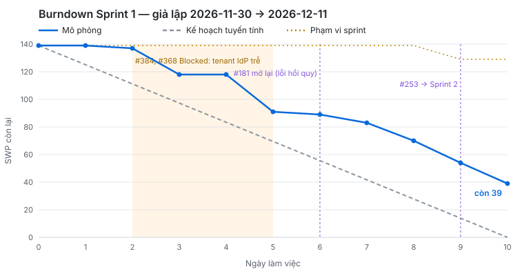

# Báo cáo tiến độ — Sprint 1 (giả lập)

- Iteration: **Sprint 1** — field Iteration `Sprint` trên [GitHub Project](https://github.com/users/huongnv-0154/projects/2), 2026-11-30 → 2026-12-11 (10 ngày làm việc). Sprint 2 (2026-12-14) đã xếp sơ bộ.
- Khoảng thời gian giả lập: trọn Sprint 1. Báo cáo viết **tại thời điểm kết thúc Sprint 1 (2026-12-11)**, lập ngày 2026-10-14; lịch sử trên từng issue là comment "Giả lập Sprint 1 · ngày N (ngày)".
- Kế hoạch: 45 issue · 139 SWP · 208,5 giờ, chọn bằng `scripts/plan-sprint.mjs` theo năng lực 27 giờ/người và chuỗi đường găng (PREMISE PR-A-02, PR-A-03, PR-A-13). Cuối sprint: 44 issue · 129 SWP sau khi chuyển #253 sang Sprint 2.

## 1. Trạng thái

<!-- GENERATED:status-summary sprint=Sprint_1 -->
| Trạng thái | Số issue | Tổng SWP | Ghi chú |
|---|---|---|---|
| Todo | 5 | 14 | #34, #270, #351, #368, #388 |
| In Progress | 6 | 18 | #89, #203, #292, #372, #384, #408 |
| Blocked | 5 | 7 | 5 câu hỏi khách E-15 chờ trả lời · #43, #44, #45, #52, #53 |
| Done | 28 | 90 |  |
| **Tổng** | **44** | **129** | snapshot 2026-10-14T13:37Z |
<!-- /GENERATED -->

Done 28 issue · 90 SWP = 70% phạm vi cuối. Năm issue Blocked đều là câu hỏi khách E-15 đã gửi, chờ khách trả lời (DoD của issue E-15, PREMISE PR-A-04), không phải việc của đội bị kẹt. Issue In Progress và Todo còn lại sẽ được đưa vào Sprint 2 khi lập lại kế hoạch ngày 2026-12-14 (mục 3).

## 2. Burndown

<!-- GENERATED:burndown -->
| Ngày | Ngày lịch | Kế hoạch còn lại (SWP) | Thực tế còn lại (SWP) | Chênh | Phạm vi (SWP) |
|---|---|---|---|---|---|
| 0 (đầu sprint) | — | 139 | 139 | 0 | 139 |
| 1 | 2026-11-30 | 125,1 | 139 | +13,9 | 139 |
| 2 | 2026-12-01 | 111,2 | 137 | +25,8 | 139 |
| 3 | 2026-12-02 | 97,3 | 118 | +20,7 | 139 |
| 4 | 2026-12-03 | 83,4 | 118 | +34,6 | 139 |
| 5 | 2026-12-04 | 69,5 | 91 | +21,5 | 139 |
| 6 | 2026-12-07 | 55,6 | 89 | +33,4 | 139 |
| 7 | 2026-12-08 | 41,7 | 83 | +41,3 | 139 |
| 8 | 2026-12-09 | 27,8 | 70 | +42,2 | 139 |
| 9 | 2026-12-10 | 13,9 | 54 | +40,1 | 129 |
| 10 | 2026-12-11 | 0 | 39 | +39 | 129 |
<!-- /GENERATED -->

Thực tế lệch kế hoạch ở bốn chỗ:

1. **Ngày 1–2 gần như đứng yên.** Các việc lớn chạy song song từ ngày 1 — dựng 4 môi trường (#392, 9 giờ) và spike JWT cho PoC SSO (#369, 9 giờ) — chưa việc nào xong trước ngày 5. Burndown chỉ giảm khi issue Done, nên việc lớn ở đầu sprint làm đường đi ngang.
2. **Ngày 3–5 tenant Entra thử của khách chưa cấp** (PR-A-04): #384 (tạo tenant, app registration) và #368 (spike PoC điểm 1–3) Blocked. Infra và BE-1 chuyển sang việc khác nên đường vẫn giảm, nhưng chuỗi PoC SSO trễ: #384 tới ngày 8 mới bắt đầu, #368 hết sprint vẫn chưa bắt đầu.
3. **Ngày 6 mở lại #181** (chặn ô 受入数量 trống): E2E hồi quy của QA thấy số lượng 0 bị coi như ô trống. Sửa mất thêm khoảng nửa số giờ ước (2,5 giờ), #181 Done lại ngày 7; đường gần như phẳng ngày 6.
4. **Ngày 9 chuyển #253 sang Sprint 2** (PWA offline, 10 SWP, 15 giờ): còn dở, không kịp ngày 10. Phạm vi giảm 139 → 129 SWP; sprint giữ mục tiêu cho chuỗi IdP và môi trường.

Kết thúc còn 39 SWP. Nguyên nhân lớn nhất không phải ba sự kiện trên mà là cách lập kế hoạch: kế hoạch theo giờ danh nghĩa (27 giờ/người), trong khi giả lập chỉ dành 80% thời gian cho issue (họp khởi động, review, dựng môi trường). Hệ số 0,8 là giả định, chưa đo được trên đội thật (PR-A-13). Đo trên mô hình, chỉ giữ sự kiện tenant trễ: dành 100% giờ cho issue thì Done 88%, dành 80% thì 65%; thêm mở lại #181 và chuyển #253 thì thành 70% (phạm vi nhỏ lại). Với đủ ba sự kiện, ở 90% thì Done 78%. Bài học cho Sprint 2: lập kế hoạch theo 80% năng lực (mục 3).

Đường kế hoạch giữ theo phạm vi ban đầu 139 SWP; từ ngày 9 phạm vi còn 129 SWP (đường chấm), nên khoảng cách thực tế so với kế hoạch ở ngày 9–10 có 10 SWP là do bớt phạm vi chứ không phải làm chậm.

Năng lực dư cũng lộ ra: QA-1 rảnh 17,1 giờ (backlog gần như không có việc kiểm thủ công — estimate.md mục 4), BE-1 rảnh 3,6 giờ ngày 9–10 vì #368 phải chờ #384, FE-2 rảnh 2,2 giờ ngày 10 vì #253 đã chuyển sprint. Năm câu hỏi E-15 được hỏi lại đúng ngày đã hẹn (ngày 6–10), khách vẫn chưa trả lời.

Giờ thực tế trong giả lập bằng giờ ước (trừ phần sửa của #181), nên Sprint 1 chưa kiểm được hệ số giờ k = 1,5 của estimate.md mục 2.

## 3. Rủi ro trễ

Mốc theo lịch LAB-1: **M-03** xong phát triển và test nội bộ (2027-04-02), **M-06** xong UAT (2027-05-14). Rủi ro rút từ đọc kế hoạch Sprint 2 bằng `tkm:predict-risks` (3 góc nhìn: kiến trúc, bảo mật, phản biện).

| Rủi ro | Issue | Ảnh hưởng tới mốc nào | Hành động | Ai làm, khi nào |
|---|---|---|---|---|
| Chuỗi PoC SSO trễ một sprint: tenant cấp trễ, spike điểm 1–3 chưa chạy; code đăng nhập SSO (FG11-01) chưa xếp sprint nào | #384, #368 | M-03 — đăng nhập SSO đứng đầu đường găng LAB-1 (FG-11 → FG-10 → FG-03 → …) | Xong #384 trước pipeline; chạy #368 ngày đầu Sprint 2; xếp thêm báo cáo PoC E13-01.3 (#370, chưa xếp sprint) vào Sprint 2 khi lập lại kế hoạch và quyết định tiếp / dừng SSO trước khi code FG11-01 (#127); điểm 1–3 trượt thì dùng phương án dự phòng E13-01.4 (#433, ADR-0009) | Infra + BE-1, 2026-12-14 → 12-18; BrSE chốt quyết định trước 2026-12-25 |
| Sprint 2 quá tải theo vai: kế hoạch lập theo giờ danh nghĩa (27 giờ/người) cộng 39,5 giờ còn dở của Sprint 1, trong khi mỗi người làm thực tế khoảng 21,6 giờ (80% × 27) → 7 vai giao hàng ở 136–167% (BE-1 36 giờ, QA-Auto 32,4 giờ); QA-1 không có việc, BrSE 81% | #396, #397, #275, #235, #302, #306, #354, #358, #362, #366 | M-03 — trễ dồn sang các sprint sau | Lập lại Sprint 2 theo 21,6 giờ mỗi vai, issue dở của Sprint 1 trước; dời 8 issue Design (#275 … #366) sang Sprint 3 vì không nằm trên đường găng; vai nào còn vượt thì dời tiếp issue không nằm trên đường găng (FG-04, FG-07); QA-1 (rảnh 17,1 giờ ở Sprint 1) nhận chuẩn bị kiểm thủ công / UAT | PM, buổi lập kế hoạch Sprint 2 ngày 2026-12-14 |
| 5 câu hỏi khách chưa trả lời, chặn phần hoàn thiện nhập hàng (ngày sản xuất, người duyệt ticket nhiệt, nhãn lô) và tồn kho (lý do đổi trạng thái lô, lô HOLD) | #43, #44, #45, #52, #53 | M-03 (hoàn thiện FG-02, FG-03); nghiệm thu chức năng ở M-06 | Đã hỏi lại một lần trong Sprint 1 (ngày 6–10), vẫn chưa có trả lời: hỏi lần hai đầu Sprint 2; quá 2026-12-18 chưa trả lời thì làm theo giả định LAB-4 có tham số (PR-D-04) và ghi vào PREMISE | BrSE hỏi lần hai 2026-12-14; PM đưa vào buổi họp tuần với khách 2026-12-16 |
| #253 chuyển sang Sprint 2 làm FE-2 quá tải: phần còn lại của PWA offline (4,6 giờ) cộng 5 việc FE của FG-03, FG-05, FG-07 = 30,1 giờ, so với khoảng 21,6 giờ làm được | #253, #217, #254, #85, #259, #58 | M-03 — POD offline nằm trên luồng giao hàng FG-05 | FE-2 làm #253 trước; ngày 2026-12-18 chưa xong thì tách phần mã hoá IndexedDB thành issue riêng và chấm SWP lại; dời #58 (FG-07, không nằm trên đường găng) sang Sprint 3; BE-2 hỗ trợ phần đồng bộ | FE-2 + BE-2, 2026-12-14 → 12-18 |
| Lỗi hồi quy lọt tới QA (#181 mở lại): sửa muộn tốn hơn sửa sớm | #181, #34, #399 | M-03 | Thêm ca "受入数量 = 0" vào bộ kiểm cùng dòng (#34); cổng CI #399 chạy unit + E2E smoke trước khi merge | QA-Auto, 2026-12-14; Infra + QA-Auto: cổng CI xong trong Sprint 2 (trước 2026-12-25) |
| Infra dồn việc: #384, #388 còn dở cộng pipeline build / deploy và migration (21 giờ) | #384, #388, #396, #397 | M-06 — môi trường test / UAT; M-03 | Thứ tự #384 → #396 → #397; #388 (1,5 giờ) giao BE-2 nếu Infra hết giờ ngày 2026-12-22 | Infra; PM xem lại ở daily 2026-12-22 |

Ngoài bảng: góc nhìn bảo mật yêu cầu route worker nội bộ #377 chỉ merge khi bộ assert phủ định quyền job_worker (#372) đã Done — ghi vào DoD của #377 khi lập lại Sprint 2.
